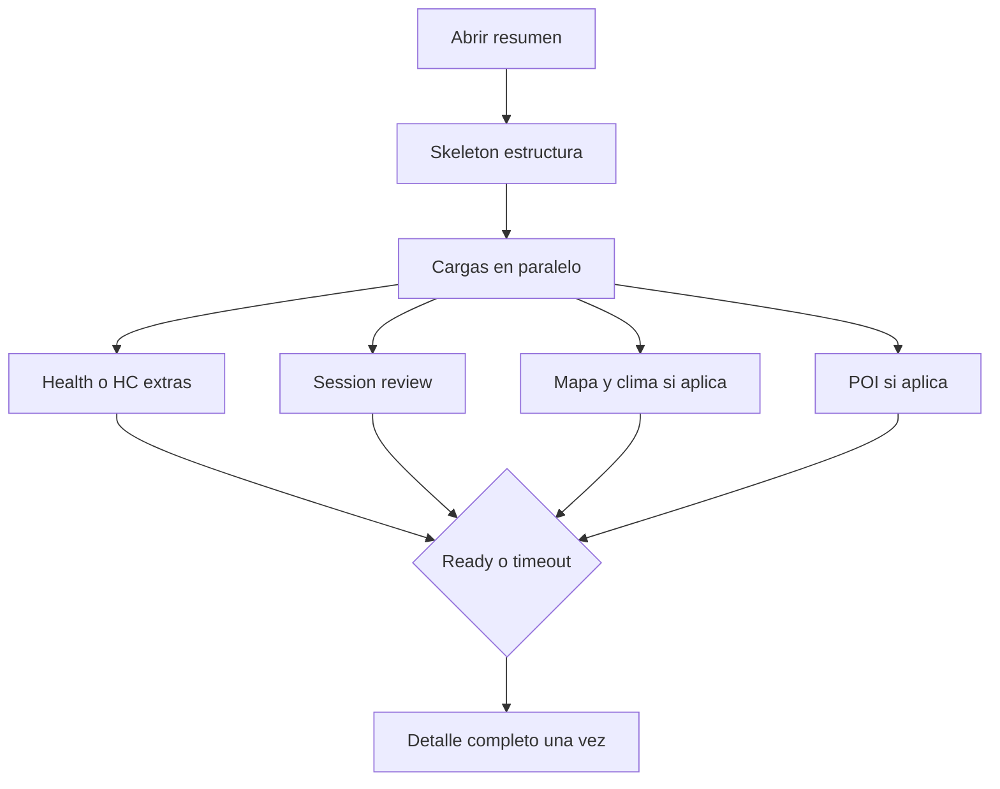

# Resumen listo de una vez + cuenta atrás de arranque en relojes

Última actualización: 2026-11-06.

## Objetivo

1. **Teléfono (iOS + Android):** al abrir el resumen de un entrenamiento/actividad ya hecho (desde Inicio u Historial), no mostrar contenido a trozos. Mostrar un skeleton hasta tener **toda** la información visible maquetada, y entonces pintar el detalle completo de una vez.
2. **Relojes (Apple Watch + Wear OS):** al comenzar un entreno o actividad desde el hub, mostrar cuenta atrás **3-2-1 a pantalla completa**; un toque en la pantalla **salta** la cuenta e inicia al instante.
3. **Fuera de alcance:** Comenzar en teléfono (el 3-2-1 del botón play se deja como está).

## Decisiones

| Tema | Decisión |
|------|---------|
| Enfoque resumen | Gate + skeleton (A): no pintar detalle real hasta ready o timeout |
| Qué espera el gate | Todo lo visible: Health/HC (kcal, FC, pasos/distancia, ruta), session review, mapa/clima, POI si aplica |
| Timeout | Fail-open a ~2,5 s tras iniciar la hidratación (no skeleton eterno) |
| Cronómetros (`timerDetails`) | Sin Health: ready tras carga local + review N/A; sin skeleton largo |
| Externas Salud | Mismo patrón skeleton → detalle completo |
| Enfoque countdown | Overlay fullscreen (A) en capa de sesión, no dentro del hub Watch |
| Flujos countdown | Hub deporte + hub plan (tras mode picker guiado/libre) |
| Toque durante 3-2-1 | Skip → iniciar (no cancelar) |
| Cancelar | Solo en el mode picker de plan, antes del countdown |
| Sensors | HK / Health Services / GPS solo al 0 o al skip |
| Audio mute | Sin pitidos; hápticos sí |
| Comenzar teléfono | No tocar |
| Bloques posteriores del plan | Sin countdown de hub (siguen con «Iniciar» / readyView) |

Nota: el spec de hub `2026-10-31-watch-wear-hub-design.md` ya mencionaba «cuenta atrás 3 s si audio on»; este documento la materializa en relojes como overlay fullscreen con skip por toque.

## Problema actual

### Resumen teléfono

- iOS `WorkoutDetailView` pinta la sesión local al primer fotograma del push; tras ~400 ms hidrata HealthKit, review y POI (`didHydrateDetail`).
- `SessionMapWeatherCard` carga clima **después**, con `isLoading` interno → tiles/clima cambian tras el “ready”.
- Android `WorkoutHistoryDetailScreen` pinta el workout al instante; `produceState` de movimiento y `HeartRateCurveSection` llegan luego y reflowean.
- No hay skeletons de estructura; el usuario ve ejercicios primero y cardio/mapa después.

### Arranque relojes

- Watch/Wear inician al instante (`playHubSport` / `startTodayPlan` / tras `WatchPlanModeOverlay`).
- No hay countdown de inicio en reloj (sí en teléfono Comenzar, fuera de alcance).

## Diseño — Resumen teléfono



### Contrato de “detail ready”

Una apertura está lista cuando se cumple **todo** lo aplicable:

1. Snapshot de sesión local disponible (título, ejercicios/bloques, tiles base).
2. Extras de Salud/HC resueltos (o claramente no aplicables: sin permiso, cronómetro, fallo).
3. `ensureSessionReview` + `refineSessionReviewWithHealth` hechos (o N/A).
4. Ruta local o de Salud resuelta si el deporte usa GPS / hay intento de mapa.
5. Condiciones de actividad / clima resueltas si hay pin o ruta para mapa (prefetch en el padre; **no** dejar loading interno en la card visible tras el reveal).
6. Sugerencia POI resuelta o descartada.

Si el timeout vence, se revela con lo disponible (valores `"—"` / secciones omitidas como hoy).

### UI skeleton

- Componente nativo nuevo ligero por plataforma (p. ej. `SessionDetailSkeleton` / `SessionDetailSkeleton.kt`).
- Estructura fija: cabecera → fila de 3 tiles → bloque métricas → lista de filas tipo ejercicio.
- Tokens `OG*` / Material surface; sin shimmer decorativo agresivo; opacidad suave o pulse discreto aceptable si ya hay patrón de animación de carga en la app.
- Nav bar / back disponibles durante el skeleton (el usuario puede salir).

### iOS — puntos de enganche

- [`Apps/Repera/Sources/HistoryView.swift`](Apps/Repera/Sources/HistoryView.swift) — `WorkoutDetailView`:
  - Sustituir paint-first del contenido real por `if isDetailReady { contenido } else { skeleton }` (mantener `initialSession` en memoria para hidratar).
  - Extender el `.task(id: sessionId)` para **prefetch de clima/condiciones** antes de `didHydrateDetail` / `isDetailReady = true`.
  - Quitar o neutralizar el loading parcial de [`SessionMapWeatherCard`](Apps/Repera/Sources/CardioRouteComponents.swift) cuando el padre ya entregó snapshot (pasar condiciones prefetcadas).
- `HealthActivityDetailView`: mismo gate + skeleton.
- Home push en [`HomeView.swift`](Apps/Repera/Sources/HomeView.swift) sin prefetch previo (el gate vive en el detalle).

### Android — puntos de enganche

- [`CompleteHistoryScreen.kt`](android/mobile/src/main/java/dev/repera/mobile/CompleteHistoryScreen.kt) — `WorkoutHistoryDetailScreen`:
  - Estado `detailReady` alimentado por una corrutina que espera movement, series FC, condiciones/mapa y review.
  - Mientras `!detailReady`: skeleton; luego LazyColumn completa.
  - Evitar `produceState` sueltos que muten tiles/secciones tras el reveal (o consumir resultados ya resueltos).
- Externas: alinear [`ExternalHealthDetailSheet.kt`](android/mobile/src/main/java/dev/repera/mobile/ExternalHealthDetailSheet.kt) al mismo skeleton.

### Timeout y transición

- El **skeleton se muestra al instante** en el push (no esperar a que termine la hidratación).
- En iOS: defer corto (~100 ms, 10/11/2026; antes ~400 ms) solo para no competir con la animación de push; timeout fail-open ~1,2 s (antes ~2,5 s) desde el inicio de la hidratación.
- Cancelación al salir de la pantalla (`Task` / `coroutineScope` cancelable).

## Diseño — Cuenta atrás Watch + Wear

```mermaid
flowchart TD
  tap[Toque hub] --> mode{Es plan?}
  mode -->|sí| picker[Mode overlay]
  mode -->|no| countdown[Overlay 3-2-1]
  picker --> countdown
  countdown --> end{Toque o 0}
  end --> yield[yield un ciclo]
  yield --> start[Arranque real HK/HS]
```

### Comportamiento

1. Usuario elige deporte en hub → overlay countdown (sin arrancar aún).
2. Usuario elige plan → mode overlay (guiado/libre/cancel) → si confirma → countdown → arranque.
3. Cada segundo: dígito grande + háptico; pitido solo si audio no está mute.
4. Toque en cualquier zona del overlay → cancelar timer → arrancar ya.
5. Al 0 → mismo arranque.
6. Tras cerrar overlay: `await Task.yield()` (Watch) / frame Compose equivalente antes de mutar hub activo.

### UI

- Fondo negro opaco (paridad `WatchPlanModeOverlay` / `WearPlanModeOverlay`).
- Número ~sistema grande centrado (Watch: font grande SF; Wear: typography display).
- Sin botones secundarios durante el countdown (toque = skip).
- zIndex por encima del hub; por debajo o en cola tras mode picker (no ambos a la vez).

### Watch — enganches

- Estado en [`WatchSessionView.swift`](Apps/ReperaWatch/Sources/WatchSessionView.swift): p. ej. `pendingStartCountdown: PendingWatchStart?` (deporte o plan+recordOnly).
- `onPlaySport`: encolar countdown en lugar de `playHubSport` inmediato.
- `commitPendingPlanStart`: encolar countdown en lugar de `startSelectedPlan` inmediato.
- Overlay nuevo `WatchStartCountdownOverlay` (mismo archivo que otros overlays o `WatchHomeHubView.swift` ya referenciado; sin carpeta XcodeGen nueva si se puede evitar).
- Al completar/skip: `Task.yield()` → `playHubSport` / `startSelectedPlan`.
- Limpiar countdown en `complicationOpenEpoch` como el resto de overlays.

### Wear — enganches

- [`WearHomeContent.kt`](android/wear/src/main/java/dev/repera/wear/WearHomeContent.kt) / hub: estado countdown tras mode picker o tap deporte.
- [`WearMainActivity.kt`](android/wear/src/main/java/dev/repera/wear/WearMainActivity.kt): diferir `startTodayPlan` / `requestLiveStart` hasta fin/skip.
- Overlay Compose fullscreen negro + dígito; tap Modifier = skip.

### Restricciones (AGENTS.md)

- No `.confirmationDialog` / `.borderedProminent` para este flujo.
- Overlay de countdown **no** dentro de `WatchHomeHubView` mutando `hub.active`.
- No doble grabación; no HK/HS durante el 3-2-1.

## Testing y contratos

- Python contratos nuevos o ampliados:
  - Resumen: gate `isDetailReady` / `detailReady` + presencia de skeleton; clima no carga solo tras reveal.
  - Watch/Wear: countdown antes de `playHubSport` / `startTodayPlan`; skip por tap; `Task.yield` / diferir start.
- Ampliar `tests/test_watch_workout_start_and_heart_rate_contract.py` (o hermano) y contrato Wear equivalente si existe.
- No afirmar hardware probado sin dispositivo.

## Docs a actualizar en implementación

- `docs/FEATURES.md`
- `docs/ARCHITECTURE.md` si describe hidratación del detalle / arranque hub
- Spec hub `2026-10-31-watch-wear-hub-design.md`: alinear “Arranque” con overlay fullscreen + skip
- `AGENTS.md` solo si surge una lección nativa nueva tras un fallo real

## Fuera de alcance

- Cambiar countdown del botón Play en Comenzar iOS/Android.
- Countdown en bloques posteriores del plan (`readyView`).
- Prefetch de Health en la lista de Inicio.
- Cambiar reglas de AuthZ / sync / Health ownership.

## Criterios de éxito

1. Abrir un cardio/fuerza desde Inicio: skeleton → un solo reveal con tiles, ejercicios, FC/mapa/clima/review sin reflow posterior material.
2. Timeout o sin permiso Salud: reveal con `"—"` / secciones omitidas, sin quedarse en skeleton.
3. Watch/Wear: tras play deporte o tras mode picker, 3-2-1 grande; toque inicia ya; sin start de sensores antes.
4. Comenzar teléfono idéntico al actual.
